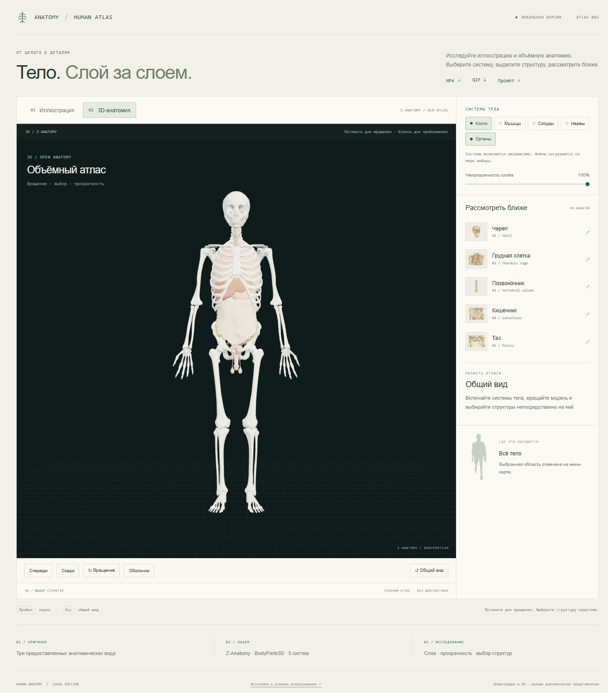

# Human Anatomy Inspector — интерактивный атлас

Два режима: предоставленная анатомическая иллюстрация и отдельная настоящая
3D-модель Z-Anatomy / BodyParts3D. Готовый код, модели и экспорты включены
в репозиторий. Веб-демо запускается локально; удалённый сайт пока не публиковался.



[Превью разбора исходной иллюстрации](docs/illustration-demo.png) ·
[Результаты проверок](docs/qa-results.json) · [Промпт](dist/PROMPT.md)

## Запуск

Нужен Node.js 20 или новее. npm-зависимости для просмотра устанавливать не нужно:
Three.js, загрузчики, декодер и модели находятся в `dist/`.

```sh
git clone https://github.com/Arekanderu161/human-anatomy-inspector.git
cd human-anatomy-inspector
npm start
```

- Windows: дважды щёлкните `start-demo.cmd` и оставьте окно сервера открытым.
- Или выполните `npm start` в этой папке.
- Откройте **http://127.0.0.1:4176/**.

Другой порт: `npm start -- 4180`. Странице нужен HTTP-сервер: прямое открытие
`dist/index.html` через file:// не загружает модули и 3D-файлы корректно.

## Что сделано

### Иллюстрация

- Три исходных кадра 233 × 480: кости/органы, нервы/сосуды, мышцы.
- Шесть этапов 15-секундного автопоказа, пауза, таймлайн и цикл.
- Выбор черепа, грудной клетки, позвоночника, кишечника и таза.
- Увеличенные врезки сохраняют исходные пиксели и пропорции.
- Мини-карта показывает положение выбранной области.
- Палитра рассчитана методом k-means по выделенному переднему плану.

### 3D

- Пять независимых систем: кости, мышцы, сосуды, нервы и органы.
- Поворот мышью, приближение, передний/задний вид и общий план.
- Загрузка дополнительных систем по мере выбора.
- Прозрачность слоёв, выбор отдельной структуры нажатием и изоляция.
- Кнопка «Оболочки» показывает фасции мышечного набора; по умолчанию они
  скрыты, чтобы не закрывать видимые мышцы.
- Пять региональных кнопок выделяют связанные элементы настоящей модели.
- Исходные английские названия структур и русские названия известных областей.

Иллюстрация и модель — разные анатомические представления. Связь областей
носит учебный характер и не является реконструкцией человека из GIF.

## Файлы

| Путь | Назначение |
| --- | --- |
| `dist/index.html`, `dist/styles.css` | Страница и оформление |
| `dist/app.js` | Иллюстрация, режимы, интерфейс, таймлайн и мини-карта |
| `dist/model-viewer.js` | Загрузка GLB, камера, материалы, выбор и изоляция |
| `dist/assets/source/` | Неизменённый GIF, кадры, маски и контуры |
| `dist/assets/models/` | Пять GLB и manifest с источниками и SHA-256 |
| `dist/vendor/three/` | Локальная Three.js 0.186.1 и Draco |
| `dist/PROMPT.md` | Промпт адаптации |
| `dist/assets/human-anatomy.gif` | Зацикленный экспорт иллюстрации |
| `dist/assets/human-anatomy.mp4` | Видео иллюстрации без звука |
| `dist/CREDITS.html` | Источники и условия использования |
| `scripts/` | Получение ресурсов, подготовка иллюстрации и экспорт |

## Проверки и редактирование

`npm test` проверяет ресурсы и сервер, включая типы GLB/WASM и видеодиапазоны.
HTML, CSS и JS редактируются напрямую, сборка не нужна. Файлы `dist/`
можно перенести целиком в папку статических ресурсов другого проекта.

Python нужен только для пересборки иллюстрации и экспортов:

```sh
python -m pip install -r requirements.txt
python scripts/prepare_illustration.py
python scripts/render_exports.py
```

`python scripts/fetch_assets.py` получает указанные в manifest версии моделей
и Three.js из открытых источников. Данные уже включены в проект.

## Источники и условия

Пользовательский GIF не перерисован. 3D-файлы — экспорт Z-Anatomy из
JMK712/human-anatomy-online, commit
`322ba39e96ea91ce08601caad2c0aaade1dc99f0`.
Оригинальные файлы GLB не изменены. Модель сжималась и экспортировалась авторами
указанного источника; в демо изменяются материалы и видимость при отображении.

Уведомления о происхождении и разных условиях отдельных компонентов
сохранены в `dist/Z-ANATOMY-NOTICE.txt` и `licenses/`. Основной набор содержит
указания CC BY-SA; отдельные исходные компоненты также содержат условия NC.
Перед дальнейшим распространением учитывайте условия выбранных элементов.
Сведения не заменяются общей лицензией программного интерфейса.

Демо предназначено для визуального изучения. Диагнозы, клинические показатели
и индивидуальные медицинские выводы не рассчитываются.
